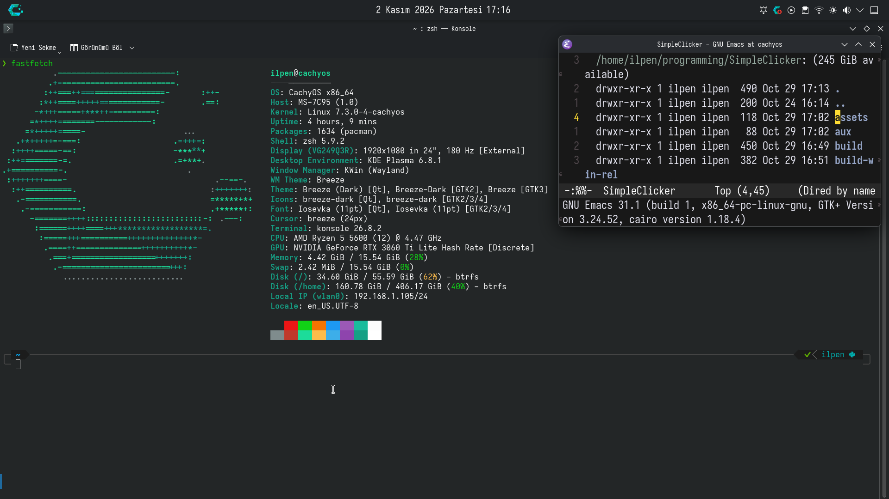

# DotFiles - Config files

This config files are meant to be work on my machine

## Requirements

- OS: CachyOS x86-64
- DE: KDE Plasma
- Text Editor: GNU Emacs
- Terminal/Shell: Konsole/zsh
- Browser: Mozilla Firefox
- Working body, brain, computer, keyboard, mouse
